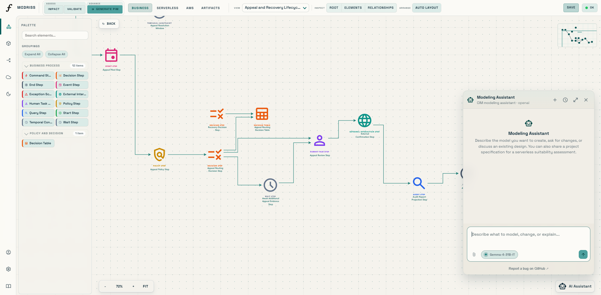
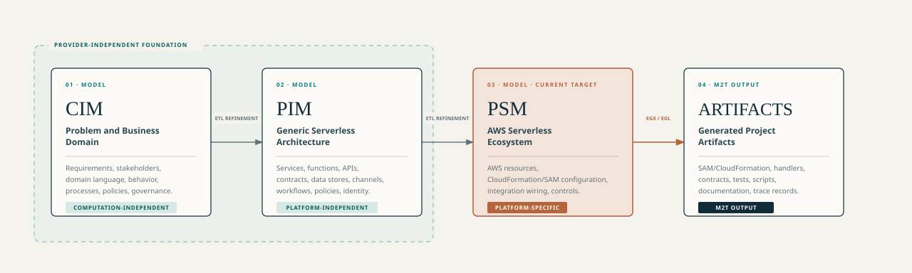

<p align="center">
  
</p>

# MODRISS

MODRISS is an ongoing research project at the [Methodology Engineering Laboratory](https://www.sharif.ir/en/web/me_ce/home),
Department of Computer Engineering, Sharif University of Technology. It studies how serverless software development can be supported by an explicit development process, domain-specific modeling languages, model transformations, and code generation.

It also explores LLM-assisted modeling and the use of large language models to support human modelers
in authoring, inspecting, explaining, and controlled modification of models expressed in these domain-specific modeling languages.

This repository contains the MODRISS development process, modeling framework, and web-based
low-code platform. AWS is the built-in cloud target. Users can extend the PSM level with their
own Ecore metamodels and Epsilon transformation and generation packages. A project can retain
separate PSMs and generated projects for several providers, all derived from the same CIM and
PIM models. The CIM and PIM languages remain fixed.



## Research context

Serverless computing reduces direct server-management work while creating concerns across
architecture, configuration, integration, operations, and deployment. MODRISS investigates a
model-driven methodology that connects domain understanding, provider-independent serverless
architecture, provider-specific design, and generated implementation artifacts in a traceable path.

The methodology has two connected parts:

- **Development process**: lifecycle phases, roles, tasks, work products, decision gates,
  iterations, and umbrella activities for serverless projects.
- **Modeling framework**: DSMLs and metamodels, semantics and constraints, concrete syntax,
  transformations, code generation, and platform support.

## Contributions and capabilities

| Area                 | MODRISS contribution                                                                                                                                                                 |
| -------------------- | ------------------------------------------------------------------------------------------------------------------------------------------------------------------------------------ |
| Development process  | An iterative and incremental process definition links modeling work with lifecycle activities, roles, tasks, artifacts, review points, and supporting practices.                     |
| Modeling framework   | Fixed CIM and PIM languages describe the business domain and generic serverless architecture. The PSM language describes the selected cloud platform.                                |
| Language engineering | Ecore metamodels specify abstract syntax. EVL rules express well-formedness and semantic validation. Browser editors provide concrete notation.                                      |
| Model refinement     | ETL transformations support semi-automated CIM-to-PIM and PIM-to-PSM refinement. Modelers review and complete decisions that cannot be resolved automatically.                       |
| Artifact generation  | EGX and EGL templates generate a reviewable AWS project baseline, including infrastructure, Go handlers, contracts, tests, workflows, scripts, documentation, and trace information. |
| Cloud extensibility  | Users upload PSM metamodels and Epsilon packages to add providers. One CIM and PIM can lead to several provider models and separate generated projects.                              |
| AI-assisted modeling | A conversational LLM-based assistant supports CIM and PIM modeling activities using the live metamodel as its structural contract.                                                   |

## Modeling path



- **CIM, Computation-Independent Model**: domain concepts, actors, capabilities, events,
  processes, policies, governance, and requirements without a software or cloud commitment.
- **PIM, Platform-Independent Model**: serverless services, functions, contracts, data, events,
  workflows, integrations, security, policies, and deployment concerns.
- **PSM, Platform-Specific Model**: resources and configuration for a selected cloud provider.
  The built-in AWS language covers compute, APIs, storage, messaging, identity, networking,
  and observability; uploaded Ecore metamodels define the languages for other providers.

Transformations support systematic refinement. Generated models and artifacts remain subject to
human review and project-specific decisions.

## Extend cloud support

Open **Cloud platforms** from the workspace rail to add a provider package. Supply its PSM
language as an `.ecore` file, PIM-to-PSM transformation rules as an ETL ZIP, and artifact
generation scripts and templates as an EGX/EGL ZIP. An optional EVL ZIP supplies constraints
for explicit model validation. Ecore alone provides an editor; the script packages enable
the corresponding transformation, generation, and validation actions. Users can customize
views, palette groups, and icons in the package's **Visual notation** tab.

From the PIM workspace, select a target provider beside the generation button. For example,
the same saved PIM can produce both the native AWS model and a model for an uploaded Azure
package. Each custom package maintains one PSM; regenerating it updates that model and keeps
previous artifact bundles. The provider tab and Artifacts tab let users switch between the
models and their generated projects without recreating the business or serverless models.

The [custom cloud platforms guide](docs/public-docs/docs/guides/custom-cloud-platforms.md)
describes the package contract and workflow. A
[minimal Azure example](methodology/modeling-framework/samples/custom-psm-azure/)
demonstrates the extension mechanism with small text outputs.

## Run the platform

### Prerequisites

- Docker with Compose support
- A modern browser
- Several gigabytes of available memory and disk space

Java 17+, Maven 3.9+, Python 3, and Node.js are required only for source development. AWS CLI,
SAM CLI, and Go are needed when verifying or deploying generated projects.

From the repository root:

```bash
./scripts/dev.sh
```

| Service                        | Address                                 |
| ------------------------------ | --------------------------------------- |
| Modeling workbench             | <http://127.0.0.1:8082>                 |
| Backend health                 | <http://127.0.0.1:8080/api/health>      |
| API explorer                   | <http://127.0.0.1:8080/swagger-ui.html> |
| Research landing page          | <http://127.0.0.1:8083>                 |
| Container logs                 | <http://127.0.0.1:9999>                 |
| AWS emulator, Floci by default | <http://127.0.0.1:4566>                 |

For a first workflow, register a user, create a project, and open the CIM workspace. Create a
model or import [`methodology/modeling-framework/samples/cim.xmi`](methodology/modeling-framework/samples/cim.xmi), validate it, then generate and review
the PIM and PSM models. From PSM, select **Generate Artifacts** and inspect or download the
generated project. The [climate-relief sample](methodology/modeling-framework/samples/climate-relief-grants/) offers a broader
end-to-end case study.

See the [quickstart](docs/public-docs/docs/getting-started/quickstart.md) and
[local-development guide](docs/public-docs/docs/getting-started/local-development.md).

To study the framework independently, run `npm --prefix apps/academy run dev` and open
<http://127.0.0.1:8085>. [MODRISS Framework Study](apps/academy/README.md) provides a DSML
metamodel reference, an interactive CIM-to-artifact dependency workspace, correspondence prediction
exercises, transformation and generation definitions, semantic-rule documentation,
study modules, and recorded makerspace case-study models. It requires Node.js and Python and runs without
the backend or database.

## Assistant and validation boundary

The LLM-based assistant is disabled by default. Enable it only after configuring a supported
provider, credentials, operating limits, and organizational policy in [`.env.example`](.env.example).
It supports CIM and PIM sessions; PSM chatbot sessions are outside the implemented scope.

Assistant-generated actions, patches, proposals, checkpoints, and model output are gated only by
structural Ecore/EMF conformance before they are applied or committed.

Read the [AI assistant guide](docs/public-docs/docs/guides/ai-assistant.md) before enabling it.

## Production and research-use notice

MODRISS is under active research and development. Generated projects are engineering baselines. Before production deployment, the responsible team
must review generated code and infrastructure, complete recorded manual actions and protected
regions, test the artifact, manage secrets, establish security and operational controls, and make
deployment-specific decisions. The project documentation does not replace those responsibilities.

For operations guidance, see [deployment](docs/public-docs/docs/operations/deployment.md),
[security](docs/public-docs/docs/operations/security.md), and
[testing](docs/public-docs/docs/operations/testing.md).

## Repository map

| Path                               | Purpose                                                                           |
| ---------------------------------- | --------------------------------------------------------------------------------- |
| [`apps/`](apps/)                   | Backend, modeling workbench, and landing site                                     |
| [`methodology/`](methodology/)     | Development process and modeling framework                                        |
| [`packages/java/`](packages/java/) | Platform modules, MDE runners, assistant, and PostgreSQL adapter                  |
| [`tools/`](tools/)                 | Standalone CLIs for Ecore compilation, validation, transformation, and generation |
| [`docs/`](docs/)                   | Public documentation, API contracts, diagrams, and engineering references         |
| [`deploy/`](deploy/)               | Docker Compose stack and container definitions                                    |
| [`scripts/`](scripts/)             | Development, deployment, database backup/restore, and repository automation       |
| [`infra/`](infra/)                 | Observability dashboards and alert rules                                          |

The [repository layout reference](docs/public-docs/docs/reference/repository-layout.md) explains
the module structure and Maven dependency direction. The formal sources of truth are located in
[`methodology/modeling-framework/metamodels/`](methodology/modeling-framework/metamodels/), [`methodology/modeling-framework/validation/`](methodology/modeling-framework/validation/),
[`methodology/modeling-framework/transformations/`](methodology/modeling-framework/transformations/), and
[`methodology/modeling-framework/generation/awspsm-to-artifacts/`](methodology/modeling-framework/generation/awspsm-to-artifacts/).

[`methodology/process/`](methodology/process/) contains process definitions, the method library,
and coverage matrices. [`methodology/modeling-framework/`](methodology/modeling-framework/)
contains metamodels, notation, validation, transformations, generation, and samples.

## Documentation

- [Public documentation](docs/public-docs/)
- [Model-driven engineering concepts](docs/public-docs/docs/concepts/model-driven-engineering.md)
- [Full-lifecycle software development process](methodology/process/software-development-process.md)
- [Capability-increment process](docs/public-docs/docs/guides/end-to-end-modeling-methodology.md)
- [REST API reference](docs/public-docs/docs/reference/rest-api.md)
- [OpenAPI contract](docs/api/openapi/openapi.yaml)
- [Generated artifact guide](docs/public-docs/docs/guides/generated-artifacts.md)
- [Architecture documentation](docs/public-docs/docs/architecture/system.md)

## Research output

Eidi, M., and Ramsin, R. (2026). _Model-Driven Approaches for Serverless Software Development:
Evaluation and Future Directions_. In the 14th International Conference on Model-Based Software and
Systems Engineering (MODELSWARD 2026), pp. 560–567.
[https://doi.org/10.5220/0014634200004058](https://doi.org/10.5220/0014634200004058)

> **Summary.** The paper evaluates selected model-driven approaches for serverless and
> microservices development with a process-centered template. It provides part of the research
> basis for the MODRISS methodology.

Mehdi Eidi. _Model-Driven Methodology for Serverless Software Development_. MSc thesis,
Department of Computer Engineering, Sharif University of Technology. **Ongoing.**

Eidi, M., and Ramsin, R. _MODRISS: AI-Assisted Model-Driven Methodology for Serverless Software Development_.
Manuscript in preparation; **Ongoing.**

## Project contacts

- [Mehdi Eidi, researcher homepage](https://mehdieidi.github.io/)
- [Lab profile](https://www.sharif.ir/en/web/me_ce/w/mehdi-eidi)
- [Methodology Engineering Laboratory, Sharif University of Technology](https://www.sharif.ir/en/web/me_ce/home)

## Contributing

Contributions are welcome where they support the research and engineering goals of MODRISS. Read
[CONTRIBUTING.md](CONTRIBUTING.md) before proposing a change. Changes to a DSML must remain aligned
across its metamodel, validation rules, transformations, visual notation, API behavior, samples,
and documentation.

Format the Emfatic metamodels with `python scripts/format-emf.py` from the project root.
Use `--check` to check without writing or `--diff` to preview changes. See the
[Emfatic formatter guide](scripts/README-emf-formatting.md) for rules and options.

## License

MODRISS is released under the [MIT License](LICENSE). Copyright © 2026 Mehdi Eidi.
