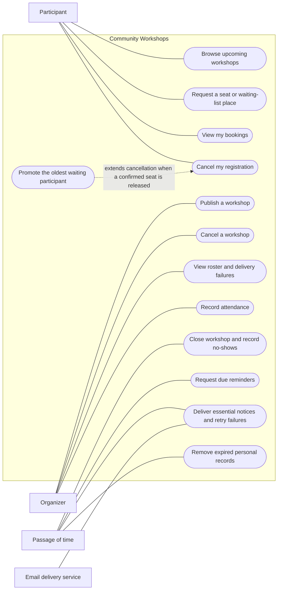

# Community Workshops

A small community centre runs free, in-person workshops such as bicycle puncture repair and beginner drawing. Participants need a reliable way to find a workshop, book one seat, join a short waiting list, and cancel. Organizers need a trustworthy roster and attendance record. Today, bookings arrive through messages and a spreadsheet: the last seat can be promised twice, cancellations are missed, and people on the waiting list are forgotten.

The proposed service publishes workshops, allocates seats fairly, promotes waiting participants automatically, sends essential notices and reminders, and records attendance. A participant can understand the main task in one sentence: **find a workshop, request a seat, and immediately see whether the seat is confirmed or waitlisted.**

This is a specification and complete CIM reference model for evaluating MODRISS. It is not an implemented booking application. The reference model describes business intent; model refinement and completion of generated business logic are part of an end-to-end experiment.

## Scenario

Nora organizes a bicycle repair workshop for two people. She publishes its time, venue, and capacity. Alice and Ben request seats and receive confirmations. Cara requests a seat and is told she is first on the waiting list. Alice cancels before the booking cutoff. Her seat is released and Cara is confirmed in the same business operation; a new requester cannot take the seat ahead of Cara. Both receive notices. A temporary email failure delays Cara's notice, but her confirmed place remains visible in her bookings. The delivery is retried without allocating another seat.

Before the workshop, confirmed participants receive a reminder. At the workshop Nora marks Ben as attended. Cara does not arrive. When the workshop ends, Cara becomes a no-show and any remaining waiting entries expire. Thirty days later, identifying booking and notice records are removed while anonymous attendance totals remain.

## Scope and actors

- **Participant:** an identified community member; browses workshops, requests one seat for themselves, views their own bookings, and cancels before the cutoff. Joining the waiting list explicitly agrees to automatic confirmation if a seat opens before the cutoff.
- **Organizer:** a centre staff member; publishes and cancels workshops, views rosters and delivery failures, and records attendance.
- **Passage of time:** initiates reminder checks, eligible delivery retries, workshop closure, and retention cleanup. This is a business actor, not a choice of scheduler technology.
- **Email delivery service:** accepts essential booking messages. Acceptance is observable; arrival in a person's inbox is outside the system's control.

One centre, free workshops, one seat per participant per workshop, capacity 1–30, and at most ten waiting participants per workshop. A participant may book different workshops. After cancelling, they may request again with a new request identifier; their waiting priority starts again. There is no payment, equipment inventory, multi-seat booking, recurring series, attendance editing, or account administration. Test identities and organizer permissions are provisioned before an experiment. Once published, workshop details are immutable; an organizer can cancel and publish a replacement.

All instants are stored with an unambiguous UTC offset and displayed in the centre's configured timezone. The reference fixture uses UTC. Booking and participant cancellation close exactly two hours before the start. Publication must be at least 26 hours before the start. Workshop cancellation remains possible until the start. Attendance is recorded during `[start, end)`. Closure occurs at or after the end. Interval endpoints are part of the requirements, not implementation choices.

## Use-case diagram

Mermaid flowchart notation represents actors, use cases, and the system boundary; solid undirected links are actor associations. The dashed relationship marks conditional waiting-list promotion.

Promotion is an automatic part of cancelling a confirmed registration; it is not a separate operation a participant must invoke. Notice delivery is a separate asynchronous business process after a change is committed.

## Files and use in MODRISS

- [Requirements and acceptance criteria](requirements.md): the baseline contract, including negative outcomes and quality targets.
- [CIM reference model](community-workshops.cim.xmi): all requirements, actors, goals, data, behavior, rules, processes, exceptions, and governance.
- [Model guide and traceability](model-guide.md): business boundaries, record lifecycles, policy decisions, and what needs refinement later.
- [Evaluation scenarios](evaluation-scenarios.md): deterministic fixtures, observable test oracles, participant tasks, and evidence to collect.
- [Validation and reproduction](validation.md): verification commands and the boundary of the evidence.

Create a new project in the workbench, select **CIM**, choose **Import → XMI**, and select `community-workshops.cim.xmi`. Import replaces the current model, so use an empty evaluation project. Save, run the explicit **Validate** action, and use the domain, behavior, process, and governance views to inspect the model. Continue through CIM-to-PIM generation, review/refinement, AWS PSM generation, and artifact generation. The evaluation guide distinguishes a successful transformation from a working deployed application.

## Why this fits serverless development

Requests arrive in short bursts when a workshop is announced. Browsing and seat requests are short interactions; records outlive individual requests. Notifications can be processed asynchronously and retried independently. Reminders, closure, and cleanup are time-driven. There is no continuously running computation or specialized hardware dependency. A strong consistency boundary per workshop protects seat allocation and waiting order; asynchronous delivery does not weaken that boundary. These properties provide useful serverless design decisions without introducing an unfamiliar business domain.

The reference model deliberately covers an end-to-end vertical slice rather than every MODRISS construct or cloud service. Expert evaluation can assess whether these familiar business rules remain traceable through architecture, generated artifacts, and executable acceptance tests.
