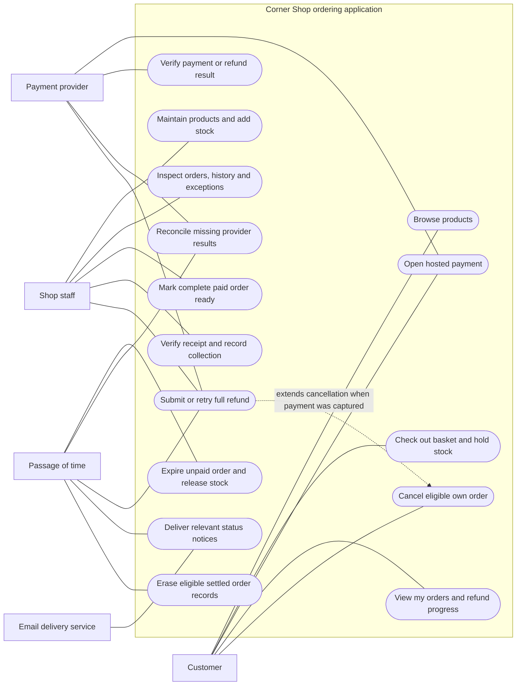

# Corner Shop

Corner Shop is a small stationery retailer that wants customers to order online and collect from the store. Customers browse familiar products, choose quantities, pay online, and collect when staff marks the order ready. Staff manage stock and prepare paid orders. The service must never promise the same last item to two customers or lose track of money owed after cancellation.

This is a small-to-medium ecommerce scenario for evaluating MODRISS, with a complete CIM reference model and testable requirements. The main customer task is **choose a few products, place an order, pay, and collect it**. The reference artifacts specify the application; business implementation and deployment remain later experiment activities.

## Scenario

Alice orders two notebooks at $5 each and one pen at $2. Checkout reserves all three items for fifteen minutes and shows a $12 total. Another customer cannot buy those reserved units. Alice pays through a hosted payment page. Only a verified payment result changes her order to paid; a browser redirect alone does not.

Nora, a shop staff member, packs the complete order and marks it ready. Alice receives pickup instructions, presents her order receipt and identity, and collects the goods. Staff records the collection once. If email is delayed, Alice can still see the authoritative status in her orders.

Ben abandons another order. Its fifteen-minute hold expires and all its units become available again. If the provider later reports that Ben was charged, the expired order stays closed and a full refund is owed. The service must not take those units away from a new buyer. If Alice instead cancels a paid order before it becomes ready, stock is restored immediately and her receipt says **refund pending** until the provider verifies completion.

## Scope

- One store with up to twenty active stationery products, one currency (USD cents), and prices including all charges for this fictional shop.
- A basket has one to five distinct products and one to five units of each. It remains a customer draft until checkout; there is no separate persistent cart feature.
- Online payment uses a sandbox hosted provider. One order has one payment session/capture and at most one full refund. Card data stays with that provider.
- Complete pickup orders only: no shipping, tax engine, coupons, marketplace sellers, partial fulfillment, substitutions, returns after collection, or partial refunds.
- Identities and verified contact details are provisioned before an experiment. Product and stock management, order processing and refund attention are in scope; account administration is not.
- Staff can mark paid orders ready and record collection. Customer cancellation closes when readiness commits. Uncollected ready orders remain visible for staff follow-up; no unstated automatic cancellation policy applies.

These limits keep the business understandable while retaining meaningful ecommerce decisions: multi-product transactions, immutable price snapshots, stock reservations, asynchronous payments, compensation, replay protection and fulfillment.

## Actors

| Actor                  | Responsibility                                                                                                                      |
| ---------------------- | ----------------------------------------------------------------------------------------------------------------------------------- |
| Customer               | Browse, check out their basket, open payment, inspect and cancel their own eligible orders                                          |
| Shop staff             | Maintain products and stock, prepare/hand over orders, inspect history and payment exceptions, retry an exhausted refund obligation |
| Payment provider       | Host payment, expose authenticated capture/refund results and a reconciliation ledger                                               |
| Email delivery service | Accept essential order-status notices                                                                                               |
| Passage of time        | Initiate expiry, reconciliation, eligible retries and retention checks                                                              |

## Use-case diagram

Mermaid flowchart notation represents actors, use cases and the system boundary. Solid links are actor associations; the dashed link is a conditional extension.

A late captured payment also creates a refund obligation, even when the customer never requests cancellation. Stock restoration and the refund obligation are committed together; returning money through the provider is a separate recoverable process.

## Artifacts

- [Requirements and acceptance criteria](requirements.md): 23 mandatory requirements, explicit error cases, quality targets and given/when/then criteria.
- [CIM reference XMI](corner-shop.cim.xmi): requirements, goals, actors, concepts, relationships, consistency boundaries, commands, queries, facts, processes, policies, decision tables and governance.
- [Model guide and traceability](model-guide.md): record lifecycles, time boundaries, stock accounting, payment/refund decisions and refinement work.
- [Evaluation scenarios](evaluation-scenarios.md): a fixed catalogue/clock, expected results, failure injection and proposed expert/user activities.
- [Verification and reproduction](validation.md): structural/EVL results, editor import/export compatibility and CIM-to-PIM generation checks.

In an empty workbench project, select **CIM → Import → XMI** and choose `corner-shop.cim.xmi`. Import replaces the current model. Save and use the explicit **Validate** action, then inspect the domain, behavior, process and governance views. The model can then be refined through PIM, AWS PSM and generated artifacts using the evaluation guide.

## Why serverless is appropriate

Catalogue reads and checkout are short requests with occasional bursts. Durable data preserves orders and stock across requests. Provider facts, refunds and notices are asynchronous work; holds, reconciliation, retries and cleanup are time-driven. No continuously running computation or special hardware is required. The important design work is preserving atomic inventory changes and durable obligations while independent background work can fail and restart. The CIM describes those business guarantees without choosing functions, queues, databases or cloud vendors.
